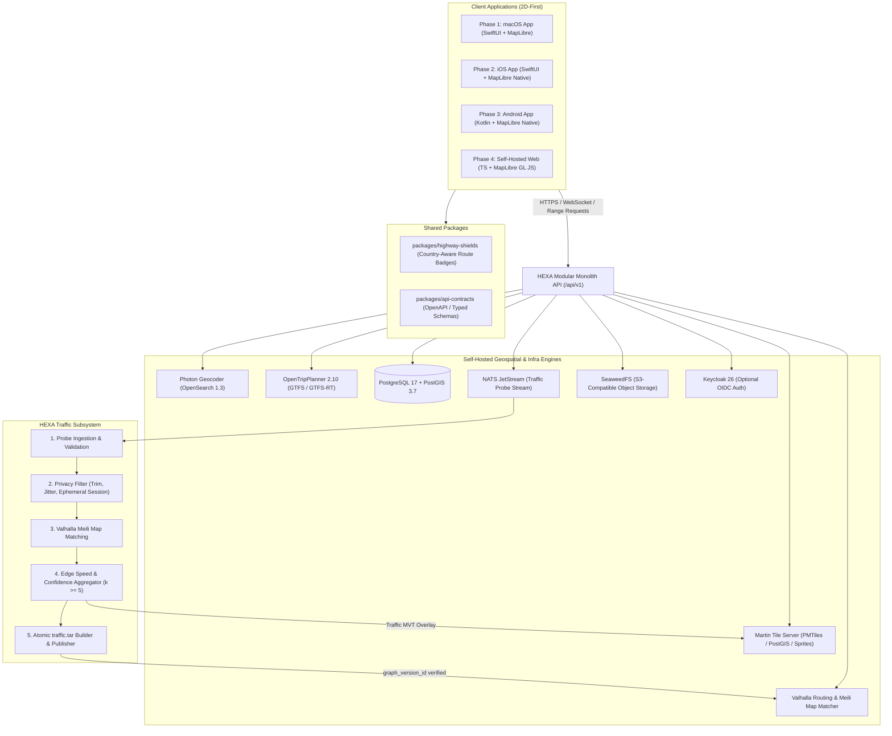

# HEXA MAPS — Architecture Proposal

**Status:** Proposed for Gate 0 / Gate 1 Approval
**Date:** 2026-11-13

---

## 1. Architectural Principles

1. **Modular Monolith First, Dedicated Geospatial Engines Beside It:**
   All HEXA application logic (`search`, `places`, `routing`, `navigation`, `traffic-ingestion`, `traffic-processing`, `traffic-publishing`, `transit`, `offline`, `accounts`, `saved-places`, `contributions`, `reviews`, `media`, `location-sharing`, `notifications`, `provider-registry`, `administration`, `observability`) resides in a single, strongly-typed **Application Backend (Modular Monolith)** with strict internal module boundaries. Heavy C++/Rust/Java geospatial engines (**Martin**, **Valhalla**, **Photon**, **OpenTripPlanner**, **PostGIS**) run as separate stateless/stateful containers orchestrated via Docker Compose.
2. **2D-First Everywhere:**
   No 3D globe, 3D building extrusions, or 3D terrain meshes. All map styles (`light`, `dark`, `navigation`) enforce `pitch: 0` (`maxPitch: 0`) and 2D Mercator projection.
3. **Provider Independence:**
   Every external or engine integration implements a domain-owned interface inside `provider-registry`. No Valhalla-, Photon-, or Gemini-specific JSON structure leaks directly to client apps without passing through versioned HEXA API schemas (`/api/v1/...`).
4. **Graph-Version-Aware Traffic Pipeline:**
   Every Valhalla routing graph build generates a cryptographic `graph_version_id` (SHA-256 of the `.osm.pbf` digest + Valhalla configuration + build timestamp). Traffic observations, map-matched edge speeds, and published `traffic.tar` archives are strictly keyed by `graph_version_id`.

---

## 2. System Topology

---

## 3. Application Backend Runtime Selection

In `docs/03_TECH_STACK.md`, three candidates are identified for the greenfield modular monolith:
1. **TypeScript (Fastify / Node 22+)**
2. **Go**
3. **Python (FastAPI)**

### Recommendation: **TypeScript (Fastify + TypeBox/Zod)** for the Modular Monolith API, with **Python / C++** reserved for Offline/Traffic Data Science & Valhalla `traffic.tar` Binary Tooling

**Why TypeScript (Fastify) for the primary Modular Monolith:**
- **Direct Code Sharing with `packages/highway-shields` and Phase 4 Web:** The highway shield resolver (`@americana/maplibre-shield-generator` integration), OpenAPI contract schemas, and MapLibre style builders can be written once in TypeScript and shared across the backend sprite generator, macOS/iOS/Android build pipelines, and Web client.
- **Performance & Schema Safety:** Fastify with TypeBox provides near-Go HTTP throughput, automatic OpenAPI 3.1 specification generation, and strict compile-time + runtime validation.
- **Modular Monolith Ergonomics:** Clean workspace package boundaries (`services/api/src/modules/*`) enforced via ESLint boundaries and TypeScript project references.

*(Note: If you prefer **Go** for the primary API server, we can pivot cleanly in Gate 1—this is listed in Unresolved Decisions for your confirmation.)*

---

## 4. Modular Monolith Internal Module Structure (`services/api`)

Each module exposes only its `index.ts` public service interface and DTOs:

| Module | Responsibility | Backing Engine / Storage |
| :--- | :--- | :--- |
| `provider-registry` | Dependency-injected adapters for Tiles, Geocoding, Routing, Traffic, Transit, Weather, AQI, Imagery, AI, Auth. | In-memory registry + health circuit breakers |
| `map-data` & `tiles` | Style JSON generation, highway shield sprite serving, region manifest endpoints, tile proxy/CDN headers. | Martin, SeaweedFS (`.pmtiles`) |
| `search` & `geocoding` | Forward/reverse geocoding, autocomplete, category search, deduplication, and ranking. | Photon + PostGIS POI index |
| `places` | Place profile enrichment, opening hours parsing, source attribution (`OSM` vs `HEXA_COMMUNITY`), last-verified timestamps. | PostGIS |
| `routing` & `navigation` | Driving/walking/cycling/hiking route calculation, alternatives, maneuvers, dynamic reroute evaluation, traffic-aware ETA. | Valhalla |
| `traffic-ingestion` | Opt-in probe batch ingestion, kinematics sanity checks, anti-spoofing, ephemeral token rotation. | NATS JetStream |
| `traffic-processing` | Privacy zone clipping, Valhalla `trace_attributes` map-matching, directed edge speed harmonic mean, confidence scoring (`LIVE`, `LIVE_LOW_CONFIDENCE`, `HISTORICAL`, `ESTIMATED`, `STALE`, `NO_DATA`). | Valhalla Meili + PostGIS |
| `traffic-publishing` | Compiles matched edge speeds into binary Valhalla `traffic.tar` matching active `graph_version_id`; publishes traffic vector tiles. | Valhalla `traffic.tar` + Martin |
| `transit` | Multi-modal routing, stop schedules, GTFS-RT alerts and vehicle positions (where verified). | OpenTripPlanner 2.10 |
| `offline` | Versioned regional bundle manifests (`.pmtiles` + Valhalla tile tarballs + SQLite FTS5 search packs) with SHA-256 checksums and HTTP range support. | SeaweedFS |
| `accounts`, `saved-places`, `location-sharing` | Optional OIDC user profiles, encrypted saved lists, time-boxed E2EE/capability-URL live location sharing sessions. | Keycloak + PostGIS |
| `contributions`, `reviews`, `media` | Community place reviews, road incident reports (accidents, closures, floods), Panoramax/S3 photo uploads with EXIF stripping & face/plate blur hooks. | PostGIS + SeaweedFS + Panoramax |
| `administration` & `observability` | Graph version dashboard, traffic coverage heatmap, moderation queue, OpenTelemetry metrics (zero raw coordinates in logs). | OpenTelemetry + Prometheus |

---

## 5. Country-Specific Highway Route Shields Architecture (`packages/highway-shields`)

To satisfy the **HIGH PRIORITY** global highway shield requirement across macOS, iOS, Android, and Web without divergent per-platform code:

1. **Tile Layer Contract:**
   Planetiler builds the `transportation_name` vector tile layer preserving OpenStreetMap ` route=road` relation memberships (`network`, `ref`, `ref_length`, `iso_a2` country code).Concurrent routes on the same way are emitted as distinct indexed properties (`network_1`, `ref_1`, `network_2`, `ref_2`, etc.).
2. **Shield Definition Registry (`packages/highway-shields/src/definitions`):**
   - **India:** `IN:NH` (National Highway yellow/black shield silhouette with top header), `IN:SH` / `IN:SH:*` (State Highway shield), `IN:NE` (National Expressway).
   - **United States:** `US:I` (Interstate red/blue shield), `US:US` (US Highway white cut-out shield), `US:*` (State-specific shields e.g. `US:CA` green spade).
   - **United Kingdom:** `GB:M` (Motorway blue rectangle with Transport Bold typography), `GB:A` (Primary green/yellow or non-primary white/black rectangle).
   - **Germany:** `DE:A` (Autobahn blue hexagon-point shield with white text), `DE:B` (Bundesstraße yellow rectangle with black border and text).
   - **Europe & Global:** France (`FR:A`, `FR:N`, `FR:D`), E-roads (`e-road` green rectangle), Italy, Spain, Netherlands, Switzerland, Poland, Nordic countries, Canada (`CA:transcanada`, provincial shields), Australia, Japan, South Korea, Brazil, South Africa, etc., derived from CC0 `@americana/maplibre-shield-generator` definitions and verified against official MUTCD/IRC/Vienna Convention sign standards.
3. **Dual Rendering Pipeline (Cross-Platform Parity):**
   - **Build-Time Base Sprite Atlas:** Generates 1x/2x/3x MapLibre sprite sheets (`sprites.png`, `sprites.json` with `content` text-fit boxes and `stretchX`/`stretchY` nine-slice metadata) for all stretchable parametric shields (works natively on MapLibre Native iOS, Android, macOS, and GL JS without runtime callbacks).
   - **Runtime Dynamic Synthesizer:** Handles complex multi-line or composite shields via `styleimagemissing` (Web/WKWebView) and `MLNStyle` image provider hooks (Native), plus a deterministic **Generic Fallback Pill** whenever an unknown `network` is encountered—while logging the unmapped `network` tag to telemetry for future coverage expansion.
